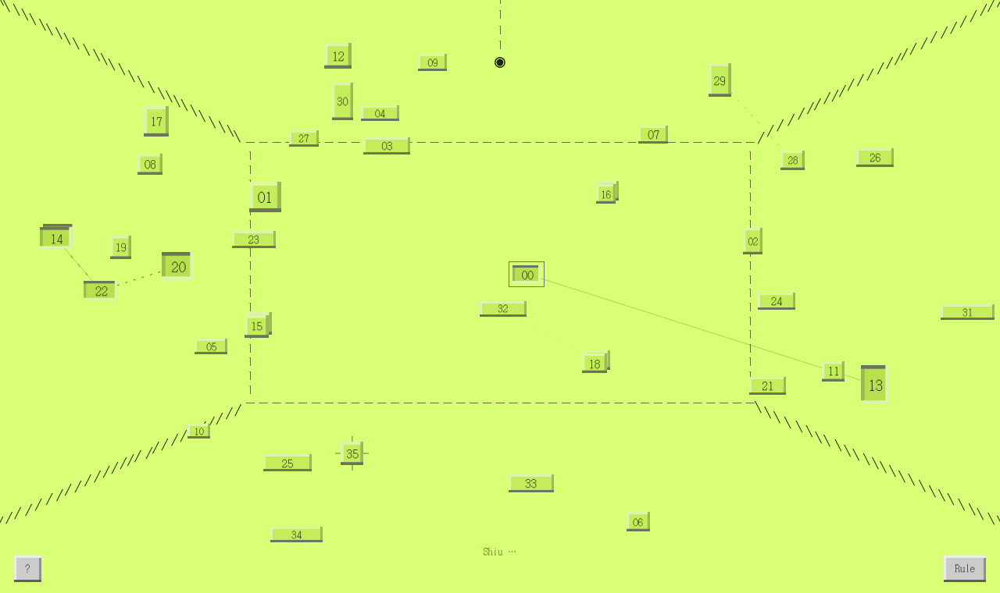
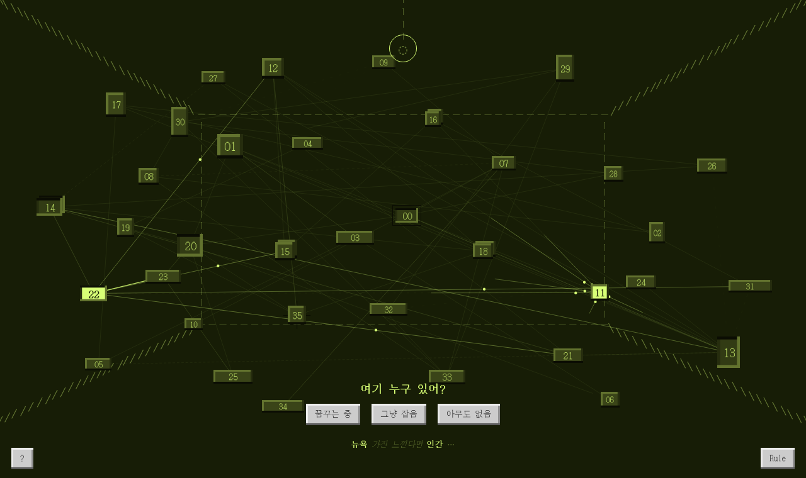
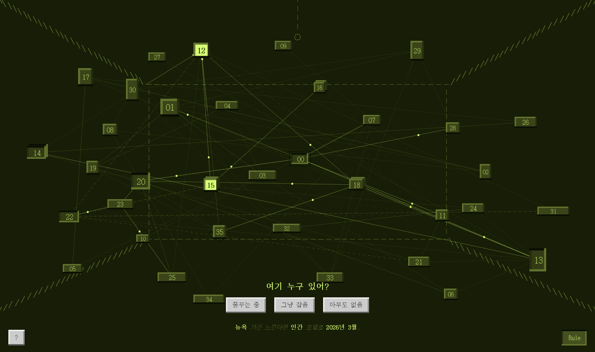
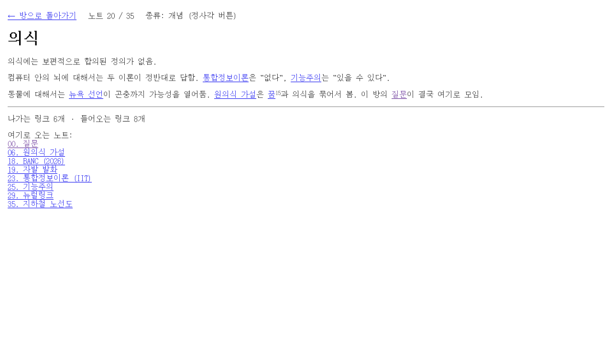

# 불 꺼진 방

> 초파리 뇌의 배선을 컴퓨터로 옮기면, 불이 꺼진 뒤에도 그 안에서 누군가 꿈을 꿀까?

웹프로그래밍 개론 8주차 개인 WIP · 현진

**▶ 작품 보기:** https://GITHUB-아이디.github.io/lights-out-room/

---

## 작품명

불 꺼진 방 (Lights Out Room)

## 질문 1문장

초파리 뇌의 배선을 컴퓨터로 옮기면, 불이 꺼진 뒤에도 그 안에서 누군가 꿈을 꿀까?

## 관객이 해볼 것

- 날아다니는 번호에 마우스를 올리면 그 번호의 노트가 썸네일로 뜸. 누르면 노트가 열림.
- 노트 안의 파란 링크를 따라 다른 노트로 건너갈 수 있음. 링크가 곧 이 방의 배선임.
- 화면 아래에는 문장이 계속 새로 생김. 번호가 켜질 때마다 그 노트에서 어절을 하나둘 뽑아 이어 붙인 거라 말이 될 듯 말 듯함. 굵은 글씨는 내가 읽은 노트에서 나온 말임.
- 연 노트, 1초 넘게 올려본 노트는 **읽은 길**로 남음. 그 번호는 눌린 버튼 모양이 되고, 길 사이 링크는 굵어짐.
- 빈 곳을 누르면 빛 자극이 들어감. 근처 번호들이 놀라서 흩어지고 발화함.
- 방 천장에 달린 전등(◉)을 누르면 불이 꺼지고 입력이 끊김. 다시 누르면 켜짐. 번호들은 제자리로 돌아가고, 방이 낮에 읽은 길을 뒤섞어 다시 재생함. 아래 문장도 그 꿈에서 나온 말로 바뀜. 기울어진 글씨는 길에 없던 노트가 끼어든 것. 잠시 뒤 "초파리는 꿈을 꿉니다..." / "초파리는 그냥 깜빡입니다..." / "초파리는 여기 없습니다..." 같은 세 문장 버튼이 뜸. 하나를 고르면 그 문장만 잠깐 남았다가 스르르 사라짐. 문장 세트는 다섯 벌이라 불을 끌 때마다 다르게 나옴.
- 오른쪽 아래의 `Rule` 버튼을 누르면 내가 짠 규칙(날아다니기, 부딪힘 연결, 꿈 재생)이 다 꺼지고 배선과 발화만 남음. 방이 거의 멈춤.

---

## 질문과 조사

### 출발점

처음 질문은 "초파리는 컴퓨터 안에서 꿈꾸고 있을까?"였음. 조사해보니 이 질문은 답이 '아무도 모름'으로 끝남. 그래서 한 단계 넓혀서 "컴퓨터 안에 의식이 생길 수 있을까?"를 진짜 질문으로 잡았고, 초파리는 그 질문에서 가장 앞서 있는 예시로 남김.

### 뇌와 컴퓨터를 잇는 세 갈래

조사한 걸 정리하니 사람들이 뇌와 컴퓨터를 잇는 방법이 세 갈래로 나뉨.

| 갈래 | 하는 일 | 대표 사례 | 아직 못 하는 것 |
|---|---|---|---|
| 꿈을 읽기 | 밖에서 뇌 신호를 읽어 꿈 내용을 맞힘 | 가미타니 꿈 해독(2013, 꿈 내용 예측 약 60%), 자각몽 실시간 대화(2021, 158번 시도 중 18.4% 정답) | 꿈을 영상처럼 녹화하기 |
| 뇌를 복사하기 | 뇌의 배선도(커넥톰)를 그려서 컴퓨터로 돌림 | FlyWire(2024), BANC(2026), Shiu 모델(2024), Eon Systems(2026) | 복사본 안에 경험이 있는지 확인하기 |
| 뇌에 접속하기 | 살아 있는 뇌에 기기를 꽂음 | 뉴럴링크(2026년 1월 기준 임상 참가자 21명) | 운동 의도 말고 꿈이나 의식 읽기 |

세 갈래 모두 지금은 **구조와 신호까지만** 옮겼고, **경험까지** 옮겨지는지는 아무도 확인 못 함. 이 빈칸이 내 질문이 들어갈 자리임.

### 왜 초파리인가

- 성체 동물 중 뇌 전체 커넥톰(뉴런과 연결을 빠짐없이 그린 배선도)이 완성된 건 초파리뿐임. FlyWire(2024)는 뉴런 139,255개, 시냅스 약 5,450만 개를 그렸음.
- 2026년 BANC는 뇌와 척수를 한 번에 그렸는데, 위에서 명령을 내리는 '결정 뉴런'이 없었음. 중앙이 없다면 '나'는 어디에 있는 걸까?
- 진짜 초파리도 하루 8~10시간 자고, 학습한 뒤에는 더 많이 잠. 다만 꿈을 꾸는지는 모름.
- 비교용으로 다른 동물: 쥐 MICrONS(2025)는 시각 피질 1mm³, 인간 H01(2024)은 측두엽 1mm³만 그렸음. 뇌 전체는 아직 멂.

### 이미 있는 웹 작업들, 그리고 그 경계

- **webgpu-fly**: 브라우저에서 초파리 뇌 전체(뉴런 139,255개)를 돌림. 그런데 뇌와 척수는 배선이 아니라 '이름'으로 이었고, 다리 리듬은 손으로 짠 코드임. 제작자가 직접 밝힘.
- **DesktopFly**: FlyWire에서 뉴런 668개, 연결 18,968개짜리 회로만 잘라서 바탕화면 초파리를 만듦. 그런데 잠·비행·그루밍은 뉴런이 아니라 상태 규칙과 애니메이션임.
- **Eon Systems**: 뇌를 가상 몸에 붙였다고 발표했지만, 정작 새로운 뇌-몸 연결 코드는 공개 안 됨.

→ "진짜 배선이 만든 움직임"과 "사람이 짠 규칙이 만든 움직임"이 한 화면에 섞여 있고, 보는 사람은 둘을 구분하기 어려움. 그래서 내 작업에서는 이 둘을 **실선(배선)과 점선(내가 짠 규칙)** 으로 나눠서 보여주기로 함.

### 의식에 대한 두 입장

- **통합정보이론(IIT)**: 일반 컴퓨터로 돌린 뇌 시뮬레이션은 뉴런을 완벽히 복사해도 경험이 없음.
- **기능주의**: 같은 계산이면 같은 마음. 시뮬레이션 안에도 누군가 있을 수 있음.
- **동물 의식 뉴욕 선언(2024)**: 곤충을 포함한 무척추동물에게도 의식 경험의 '현실적 가능성'이 있다고 봄.

불을 끈 방에서 관객이 고르는 세 답(꿈을 꾸는 중 / 그냥 노이즈 / 아무도 없음)은 이 입장들에 하나씩 대응함.

### 비유: 지하철 노선도

| 뇌 | 지하철 |
|---|---|
| 커넥톰 | 노선도 |
| 신경 활동 | 열차 운행 |
| 중앙 사령부 | 관제실 (BANC에 따르면 없음) |
| 잠 | 막차 이후 |
| 꿈 | 승객 없이 도는 회송 열차 |
| 의식 | 그 열차 안에 승객이 있는가 |

---

## 작품 구조

- 화면 전체가 `<canvas>` 하나임. 방은 유니코드 글자(`ㅡ` `ㅣ` `╲` `╱`)를 캔버스에 찍어서 그림. 가운데 벽은 간격을 두고, 옆 선은 한 방향 기호만 살짝씩 어긋나게 찍음.
- **번호 36개 = 리서치 노트 36개 = 뉴런 36개.** 노트 본문에 `[[보이는 글|번호]]`라고 쓴 부분이 하이퍼링크이자 배선이 됨. 링크가 8개 이상인 노트는 허브로 취급해서 번호가 크고, 올리면 두 단계까지 연결이 퍼짐.
- 번호 버튼은 전부 직사각형이고, 길이와 비율이 노트 종류임: 질문 = 넓은 이중 버튼 · 개념 = 정사각 · 생물·현상 = 세로 · 가설·이론 = 납작함 · 실험 = 조금 넓음 · 지도·데이터 = 겹친 버튼 · 모델·코드 = 넓음 · 기기 = 좁고 긴 세로 · 픽션 = 아주 김 · 비유 = 눈금 달림. 같은 종류도 길이가 조금씩 다름.
- 번호는 옛날 HTML 버튼처럼 그림: 위·왼쪽 테두리는 밝게, 오른쪽은 중간, 아래는 가장 어둡게 두껍게 깎음. 올리거나 읽은 번호는 명암이 뒤집혀 눌린 버튼이 됨. 화면의 `?`, `Rule` 버튼도 같은 방식의 회색 버튼임. `Rule`이 눌려 있으면(규칙 꺼짐) 어두운 올리브색으로 바뀜.
- 글꼴은 탱바 모노(Tangba Mono 20, Regular/Bold)를 페이지 안에 넣어서 씀.
- **뉴런 모델**: 새는 적분-발화(leaky integrate-and-fire)를 아주 단순하게 씀. 번호마다 전압 `v`가 있고, 가만히 두면 새어 나감. `v`가 1을 넘으면 발화해서 링크를 따라 신호(•)를 보내고, 신호가 도착하면 상대 번호의 전압이 링크 세기(0.3~0.8)만큼 올라감. 신호 하나로는 상대를 못 켜고, 여러 개가 겹쳐야 켜짐.
- **읽은 길 = 학습**: 연달아 읽은 두 노트 사이 링크는 세기가 조금씩 올라감(같이 켜진 연결이 강해진다는 학습 규칙). 읽은 길은 그 브라우저에 저장되고, `?` 패널에서 지울 수 있음.
- **꿈 재생**: 불을 끄면 읽은 길을 2~3개씩 끊어서 뒤섞고, 가끔 거꾸로 재생함. 가끔 길에 없던 노트(대부분 이웃 노트)가 끼어들고, 재생이 반복될수록 끼어드는 비율이 늘어남. 배선에 있는 도약은 실선, 없는 도약은 점선으로 그림. 기억 정리 가설(밤에 낮의 경험을 재생해서 굳힌다)을 옮긴 것.
- **아래 문장**: 번호가 발화할 때마다 그 노트 본문의 어절 하나(가끔 두 개)를 뽑아 0.5초쯤 간격으로 이어 붙임. 5~10어절이 차면 마침표를 찍고 새 문장을 시작함. 한동안 발화가 없으면 아무 노트에서나 한 마디가 떠오름. 배선을 따라 흐르는 신호를 글로 보이게 한 것.
- **Rule**: 내가 짠 규칙(무작위 비행, 부딪힘 연결, 밤에 제자리로 돌아가기, 꿈 재생)을 한 번에 끄는 스위치. 남는 건 배선, 발화 모델, 관객의 입력뿐.
- **실선** = 링크(배선). 신호가 지나갈 때 이어졌다가 1~3초 뒤 점선으로 갈라지면서 끊김. 밤의 링크 지도도 선마다 다른 주기로 이어졌다 끊김.
- **점선** = 내가 짠 규칙. 낮에 두 번호가 부딪히면 잠깐 이어짐.
- **낮/밤**: 낮에는 무작위로 날아다니고 클릭(빛 자극)을 받음. 밤에는 입력이 끊기고 제자리로 돌아감. 자발 발화 확률은 밤에 더 높게 둠.
- **노트 문서**: 주소 끝의 `#d13` 같은 해시로 열림. 일부러 브라우저 기본 스타일에 가깝게 둠(흰 바탕, 파란 밑줄 링크, 방문한 링크는 보라색). 글꼴만 탱바 모노.
- 탭을 떠나 있던 시간만큼 시뮬레이션을 실제로 돌려서(`visibilitychange`) 돌아왔을 때 발화 수를 보여줌.
- 방문한 노트와 투표는 그 브라우저의 `localStorage`에만 저장함.
- 파일 하나(`index.html`), 외부 라이브러리 없음.

---

## AI USE NOTE

사용한 AI: Claude (Anthropic)

| 단계 | AI가 한 것 | 내가 한 것 / 정한 것 |
|---|---|---|
| 방향 잡기 | 질문 방향 20개 제안 | "초파리 꿈"에서 "컴퓨터 안의 의식"으로 질문을 넓히기로 정함 |
| 리서치 | FlyWire, BANC, Eon, webgpu-fly, DesktopFly, 꿈 연구, 뉴럴링크 자료 조사·요약, 보고서 초안 | 읽고 "세 갈래 시도가 하나의 질문으로 모인다"는 구조를 고름. 우주·악보·지하철 비유 중 지하철을 고름 |
| 콘셉트 | 노드 웹사이트 / 연주될 일 없는 악보 / 방 세 가지 안 비교 | 방 안을 초파리처럼 나는 노드 안을 고름. 방 색 `#D8FF76`, 유니코드로 그린 것 같은 그래픽을 정함 |
| 코드 | HTML/CSS/JS 작성, 문법·링크 검사 | 매 버전을 보고 고칠 점을 지시함: 가운데 벽은 간격 있는 `ㅡㅡㅡ`, 옆 선은 한 방향 기호만 삐뚤빼뚤하게, 노트를 노드로, 기본 HTML 썸네일, 허브 노트 연결 효과, 노드 모양 다양화, 선 얇게, 연결이 주기적으로 끊기게, 움직임 양 조절, 번호를 HTML 버튼처럼(직접 그린 버튼 시안을 줌), 모양은 다양한 길이의 직사각형으로 통일, 글꼴은 탱바 모노로 교체, 화면 글자 줄이기(상단 제목·상태·하단 힌트 삭제, 버튼은 기본 모양, 규칙 스위치는 `Rule` 한 단어) |
| 인터랙션 보강 | 개선 방향 6개 제안(규칙 끄기, 가만히 있으면 잠듦, 읽은 길이 꿈이 됨, 꿈 문장, 관객이 연결 긋기, 다른 관객의 답) | 그중 규칙 끄기, 자동 잠, 읽은 길 → 꿈 재생 세 개를 골라서 넣었고, 써 보니 자동 잠은 마음대로 꺼져서 거슬려서 뺌. 불은 천장 전등을 눌러서만 끄게 바꿈 |

AI를 쓰면서 걸렸던 점

- AI가 처음에 FlyWire 데이터가 실제보다 훨씬 무겁다고 말했다가, 다시 조사하면서 정정함. 그 뒤로 숫자는 출처 링크를 같이 받아서 확인함.
- 비공식 출처에서만 나온 정보는 노트에서 뺌. 뉴럴링크 블라인드사이트는 실제 이식 여부를 확인 못 해서 '준비 중이었음'까지만 적음.
- 작업 중에 나도 헷갈려서 "이거 실제 초파리 데이터 쓴 거야?"라고 물어봄. 답은 아니었음. 진짜와 흉내의 경계가 만드는 사람한테도 흐려진다는 걸 느꼈고, 이게 이 작품의 질문이랑 같은 문제라서 `?` 패널에 한계를 적어둠.

---

## 실패와 배운 점

- **실제 데이터를 못 넣음.** 1주일 안에 FlyWire 데이터를 받아서 회로를 자르고 웹에 올리는 건 무리였음. 대신 리서치 노트 사이의 하이퍼링크를 배선으로 씀. 그래서 지금 방은 "초파리의 뇌"가 아니라 "초파리 뇌에 대한 내 리서치의 뇌"임. 그런데 이게 오히려 관객이 조사 내용을 직접 따라가 볼 수 있는 구조가 됨.
- **처음 질문이 너무 좁았음.** "초파리가 꿈꾸나"는 '모른다'로 끝남. 질문을 "컴퓨터 안의 의식"으로 넓히니까 꿈 읽기, 뇌 복사, 뇌 접속이 하나의 질문으로 모였음.
- **선이 계속 남아 있으니 화면이 굳어 보였음.** 링크선이 늘 켜져 있으면 그냥 거미줄 그림 같았음. 선을 얇게 하고, 이어졌다가 끊기게 바꾸니까 그제야 살아 있는 연결처럼 보임. 연결(배선)과 활동(신호)은 다른 것이라는 걸 화면으로 체감함.
- **움직임 조절.** 더 활발하게 하니까 너무 많이 움직여서 번호를 잡을 수가 없었음. 중간값으로 되돌림. 보는 재미와 읽을 수 있음 사이 균형이 필요했음.
- **발화 폭주.** 읽은 길을 학습하게 했더니 불을 끈 방이 6초에 200번 넘게 발화함. 원인을 찾아보니 학습 때문만이 아니라 원래 링크 세기가 너무 세서, 신호 하나만 받아도 상대가 켜지고 서로 계속 주고받는 상태였음(예전 버전도 노트를 여러 개 열면 똑같이 폭주함). 링크 세기를 낮춰서 여러 신호가 겹쳐야 켜지게 바꾸니까 밤이 조용해지고, 그제야 꿈 재생이 노이즈 속에서 보이기 시작함. 실제 뇌에서는 억제 뉴런이 이런 폭주를 막는다고 함. 다음엔 억제 연결도 넣어볼 것.
- **규칙을 끄니까 방이 거의 멈춤.** 이 방이 살아 보였던 건 대부분 내가 짠 코드 때문이었음. webgpu-fly나 DesktopFly에서 찾은 문제를 내 작업에서도 그대로 확인한 셈.
- **모바일.** 설명 패널이 화면 밖으로 잘리고 위쪽 글자가 겹쳤음. 스크린샷으로 확인하고 고침.
- **왜 웹인가.** 링크를 따라 읽어 나가는 행동이 신호가 배선을 따라 퍼지는 것과 같은 구조임. 관객의 클릭이 곧 이 방의 입력이고, 관객이 떠나면(탭을 닫으면) 방은 입력 없이 혼자 돔.

## 다음 단계

- FlyWire에서 실제 회로 하나(DesktopFly처럼 수백 개 뉴런 규모)를 잘라서 이 방에 넣기
- 진짜 배선(실선)과 내가 짠 규칙(점선)이 각각 얼마나 움직임을 만드는지 화면에 숫자로 보여주기
- 관객마다 다른 아래 문장(꿈)을 모아서, 같은 방이 사람마다 어떤 꿈을 꿨는지 비교하기
- 다른 관객들의 답(꿈 / 노이즈 / 아무도 없음)을 모아서 보여주기

## 팀으로 다루고 싶은 질문

**배선만 옮겨진 컴퓨터 속 존재를, 우리는 어떤 기준으로 '누군가'라고 부를 수 있을까?**

초파리가 아니어도 됨. AI 캐릭터, 게임 속 생명체(블랙미러 '플레이싱'), 디지털 트윈처럼 웹 안에 사는 다른 존재로 넓힐 수 있음.

---

## 참고자료

꿈
- [Science News: 가미타니 꿈 해독](https://sciencenews.org/article/dream-contents-deciphered-computer)
- [JST: 생성 AI를 붙인 뇌 이미지 복원](https://sj.jst.go.jp/news/202401/n0115-01k.html)
- [MIT Technology Review: 뇌 스캔으로 보는 이미지 재구성 (2026)](https://www.technologyreview.com/2026/10/01/1145588/ai-mind-reading-reconstructs-what-youre-looking-at/)
- [Vice: 자각몽 실시간 대화](https://vice.com/en/article/scientists-achieve-real-time-communication-with-lucid-dreamers-in-breakthrough)
- [Templeton: 원의식 가설 프로젝트](https://www.templetonworldcharity.org/projects-resources/project-database/33970)

커넥톰과 초파리
- [Inverse: FlyWire 성체 초파리 뇌 지도](https://www.inverse.com/health/complete-map-adult-fruit-fly-reveal-unsolved-mysteries-brain-neuroscience)
- [CASRAI: BANC, 중앙 명령 없는 초파리 신경계](https://casrai.org/news/fruit-fly-connectome-no-central-command)
- [UC Berkeley: Shiu 모델, 노트북에서 돌아가는 초파리 뇌](https://vcresearch.berkeley.edu/news/researchers-simulate-fly-brain-laptop-human-brain-next)
- [The Decoder: Eon Systems 발표](https://the-decoder.com/startup-claims-first-full-brain-emulation-of-a-fruit-fly-in-a-simulated-body/)
- [DesktopFly (GitHub)](https://github.com/DenisSergeevitch/desktop-fly)
- [webgpu-fly](https://abgunaydin-webgpu-fly.static.hf.space/index.html)
- [NIH: 쥐 MICrONS](https://www.nih.gov/news-events/news-releases/scientists-map-unprecedented-detail-connections-visual-perception-mouse-brain)
- [Google Research: 인간 H01](https://research.google/blog/a-browsable-petascale-reconstruction-of-the-human-cortex/)
- [QBI: 초파리의 잠](https://qbi.uq.edu.au/node/6786)

의식
- [arXiv: 통합정보이론과 컴퓨터](https://arxiv.org/abs/2412.04571v2)
- [Quanta: 동물 의식 뉴욕 선언](https://www.quantamagazine.org/insects-and-other-animals-have-consciousness-experts-declare-20240419/)

뇌-컴퓨터 인터페이스
- [Reuters 보도: 뉴럴링크 참가자 21명](https://whbl.com/2026/01/28/elon-musks-neuralink-says-it-has-21-participants-enrolled-in-trials/)
- [Storyboard18: 블라인드사이트 첫 이식 준비](https://storyboard18.com/digital/neuralink-readies-first-human-implant-of-vision-restoring-blindsight-device-88432.htm)
- [Timewell: 뉴럴링크·Synchron·Precision 비교](https://timewell.jp/en/columns/neuralink-precision-neuroscience-synchron-blackrock-neurotech)

픽션
- [Wikipedia: 블랙미러 'Plaything'](https://en.wikipedia.org/wiki/Plaything_(Black_Mirror))
